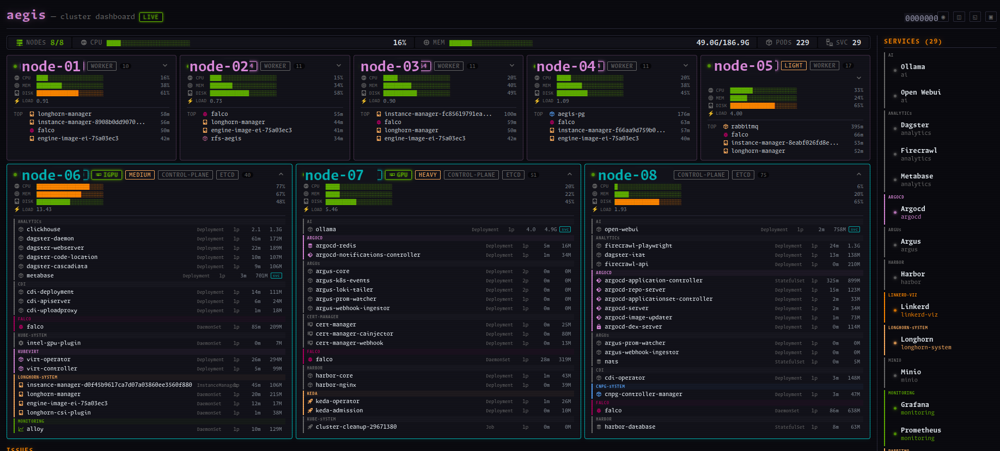
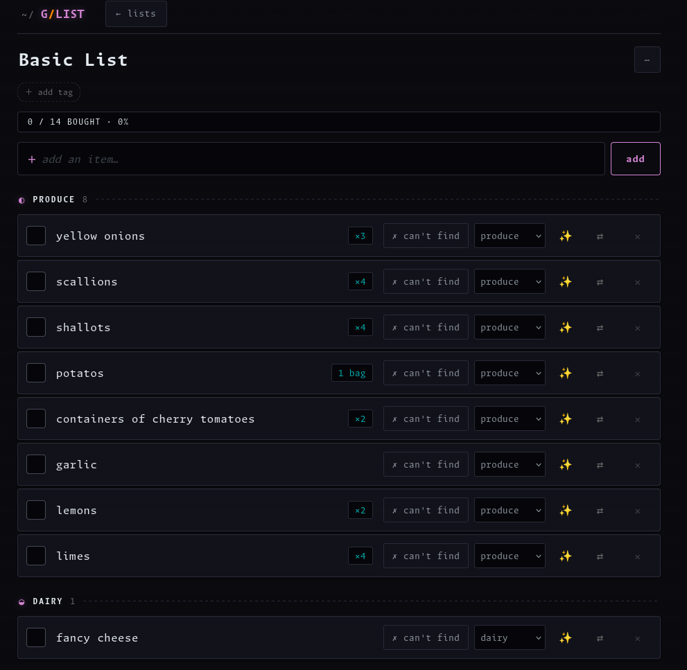
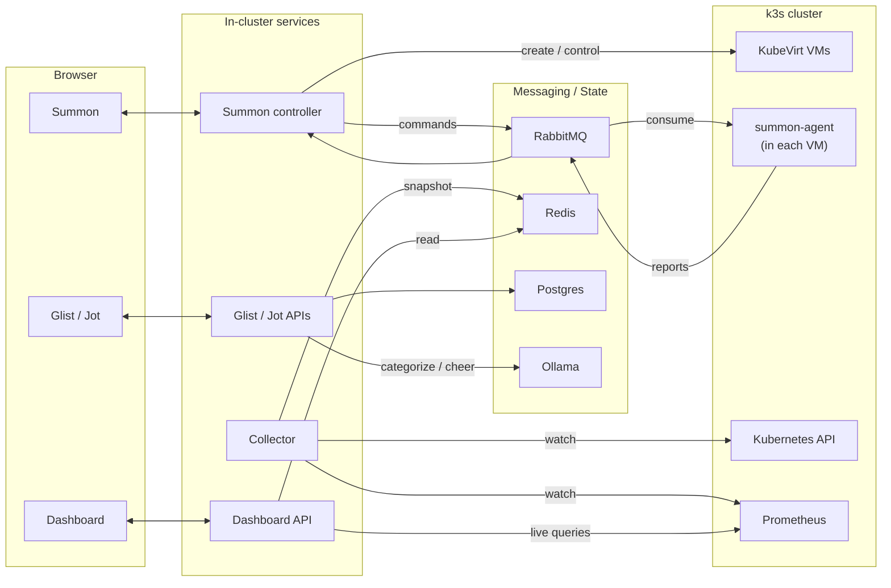

# Aegis

**A bare-metal Kubernetes homelab and some apps I had fun making for it**

Aegis is a multi-arch (x86 + ARM) k3s homelab. The full private project includes cluster infrastructure, networking, storage, GitOps, and application workloads. This repository is a sanitized public mirror focused on first-party applications. It includes a VM provisioner, a live cluster dashboard, and two self-hosted tools.

> **About this repo.** This is a sanitized public mirror of a private homelab.
> The infrastructure layer (cluster-wide manifests, secrets, node inventory, host and network details) is intentionally private. This repository contains application code plus the per-app Kubernetes manifests under `k8s/`, with internal hostnames replaced by placeholders and secrets omitted, published with a fresh standalone history. So there are some high odds it won't work out of the box.

---

## The apps

### Summon: a VM provisioner for the cluster
Summon is a Blazor Server app that manages VMs on **KubeVirt**. Users pick a template (base image, architecture, resource minimums, cloud-init input), and Summon renders cloud-init, creates the VM, and tracks lifecycle state. The fleet view streams VM state, resource usage, and pending OS updates over **SignalR**.

Summon uses a **controller/agent split**. A small Go `summon-agent` runs in each VM, connects over **RabbitMQ**, executes requested actions (install, upgrade, package inventory, command execution), and reports results. Reconciliation and orchestration stay in the controller.

> Summon (.NET 10, Blazor Server, SignalR) · summon-agent (Go, RabbitMQ) · KubeVirt · MinIO for image/artifact storage

### Dashboard: a live map of the cluster
Dashboard provides a real-time view of node health, services, topology, events, and time-series metrics. It avoids request-time dependency on the Kubernetes API.

A background collector watches Kubernetes and Prometheus and writes a denormalized snapshot to Redis. The API server reads Redis and pushes updates to the browser over WebSockets, while proxying selected live Prometheus queries for charts. The UI also renders topology as a **Mermaid** diagram and publishes an RSS event feed.

> Go (client-go informers, Prometheus, Redis) · SvelteKit · WebSockets · a hand-built WebGL topology graph

### Glist: a grocery list that thinks (a little)
Glist is a shared grocery list app with local model-assisted categorization. Entries such as "2 lbs onions" are parsed into quantity and unit and mapped to store aisles.

Categorization uses two tiers: a local lookup table for common items and a local **Ollama** model fallback for unknown items. The model also suggests substitutions and generates short completion messages. List updates are delivered in real time over WebSockets.

> Go · SvelteKit · Postgres · Ollama · WebSockets

### Jot: notes and todos, no fuss
Jot is a self-hosted notes and todo app with a Go API, Postgres storage, and a Svelte frontend.

> Go · SvelteKit · Postgres

---

## How it fits together

---

## Recurring themes

Common patterns across these applications:

- **Push, don't poll.** SignalR and WebSockets everywhere, so the UI reflects state changes without polling.
- **Keep the hot path off the slow dependency.** The dashboard reads a Redis snapshot, not the live k8s API. Glist uses a lookup table before model fallback.
- **Dumb edges, smart core.** The VM agent and the frontends hold no policy; controllers and APIs own orchestration logic.
- **Everything is configured by environment.** No hosts or secrets are baked into the code.

## License

Source-available, all rights reserved (see [LICENSE](./LICENSE)). You're very welcome to read and learn from this. Please ask before redistributing or running it as a service.
